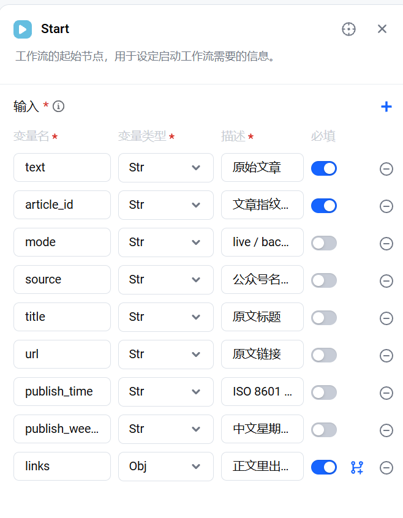

# 阶段 3 · GeniOS 工作流搭建说明（v3，Intent 门控与代码节点校验版）

> **给 [人]**：这份文档是逐节点的搭建手册。每个节点写清了「放什么、连什么、粘什么内容」。
> 全部可粘贴内容都在 `genios/` 目录里，本文只写「怎么装」。
>
> **本版目标**：保留当前已经跑通的单大模型节点，同时把三层校验接回 GeniOS 代码节点。
> worker 只接收 End 的清洗结果并入库，不再让工作流通过 HTTP 节点回写。
> 跑通之后，再按 PLAN §6 演进成「大模型1 分类 → 循环 → 大模型2 按类型抽取」的两段式。
>
> ⚠️ 界面描述来自实测与推断。**和你看到的不一样时以你看到的为准，截图给我。**

> **v3 门控设计（2026-10-15）**：用户提供的当前租户 YAML 已确认 Intent 节点的字段、分支端口和查询引用，
> 生成器按此结构输出六节点导入文件。当前租户已明确拒绝 `VariableAggregator` 节点类型，因此两个 Code 节点各输出
> 一个对象字段 `result`，由唯一 End 直接接收两路对象；worker 从实际执行分支对象中递归提取结果。

### 1.1 机会文章门控（手动接线）

第一道门使用 **意图识别**，不是选择器。选择器只能比较已经存在的变量，适合后续按
`item_count` 或 `is_opportunity` 做确定性分支；意图识别才负责从文章正文判断“机会/非机会”。

```text
Start
  ↓
意图识别（输入 Start.text；可选同时输入 Start.title）
  ├─ 机会文章 → 抽取 LLM → parse_and_validate.py ─┐
  └─ 非机会文章 → empty_result.py ────────────────┤
                                                   ↓
                                             两路结果对象 → End
```

在当前租户的画布上配置：

| 配置项 | 填写内容 |
| --- | --- |
| 意图识别提示词 | `genios/prompts/intent_gate.md` 的“节点指令” |
| 输入参数 | `Start.text`；若节点支持多个输入，可另接 `Start.title` 作为上下文 |
| 意图 1 | 名称 `机会文章`；描述见 `intent_gate.md`；连接抽取 LLM |
| 意图 2 | 名称 `Others`（界面可显示为非机会文章）；描述见 `intent_gate.md`；连接 `empty_result.py` |
| 机会分支 | 继续使用现有 `step1_extract.md` → `parse_and_validate.py` |
| 非机会分支 | 新增 Code 节点，粘贴 `genios/code_nodes/empty_result.py`，输入接 `Start.article_id` |
| 汇合 | 租户不支持 `VariableAggregator`；两个 Code 都输出 `result` 对象，End 分别接 `opportunity_result` 与 `non_opportunity_result` |

**门控依赖的租户约束（已实测）**：带 `PortID` 的分支节点只能把该分支作为自己的触发依赖，
不要再同时加入 `Start` 依赖。当前租户会把同一节点的多个 `Depends` 项当成可触发入口；
如果抽取 LLM 仍依赖 `Start`，它会绕过 Intent，在 `class_other` 分支也执行。正确依赖是：

```text
Intent(class01) → 抽取 LLM → 代码01
Intent(class_other) → 代码02
代码01 或 代码02 → End
```

意图识别只做分类，不抽取机会字段。分类规则是：学生现在或之后可以报名、申请、招募、预约或参与，
且属于 `竞赛`、`学术与学习交流`、`志愿活动与社会实践`、`校园文体活动` 四类之一，才选“机会文章”。
纯新闻、表彰喜报、获奖结果、活动回顾总结、已结束活动、招生/政策说明，以及无法确认学生行动的文章，
选“非机会文章”。边界不清时选“非机会文章”。完整提示词和意图描述见
[`genios/prompts/intent_gate.md`](../genios/prompts/intent_gate.md)。

非机会分支的 End 输出必须保持与抽取分支相同的对象形状：

```json
{"ok": false, "is_opportunity": false, "article_id": "…", "items": [],
 "first_item": null, "issues": [], "item_count": 0}
```

worker 会正常结束这篇文章，但因为 `items` 为空而不写入机会记录。这个行为依赖现有
`gateway/app/worker.py::extract_llm_payload` 的结果契约；导入后仍需用一篇机会和一篇纯新闻文章各试运行一次。

---

## 0. 前置

| 项 | 状态 |
| --- | --- |
| gateway 可被 GeniOS 访问 | ✅ S5 已验证 |
| GeniOS API 可被 gateway 调用 | ✅ Q1 已验证（`run_app_workflow`） |
| 大模型节点支持 JSON 输出 | ✅ Q2 已验证（节点有「输出格式」开关） |
| 代码节点 = Python 3.10，支持 json/re/datetime/zoneinfo | ✅ Q3 已验证 |
| 代码节点契约 | ✅ 必须定义 `def handler(inputs): ... return {...}` |

**GeniOS API 配置**：由 gateway 的 `.env` 提供。工作流只需把 End 结果返回给调用方，
不再配置 HTTP 节点访问 gateway；探针期的临时隧道仅用于早期连通性实验。

---

## 1. 节点清单与连线

```
Start → 意图识别
          ├─ class01（机会） → 抽取 LLM → 代码01（三层校验） ─┐
          └─ class_other      → 代码02（空结果） ───────────────┤
                                                               ↓
                                                两路 result 对象 → End
```

---

## 2. 逐节点配置

### 2.1 Start 节点

**参数**：与 gateway 契约（PLAN §7.1）一致。gateway 发出的请求体是：

```json
{"InputData": "{\"article_id\":\"…\",\"mode\":\"live\",\"source\":\"…\",\"title\":\"…\",
               \"url\":\"…\",\"publish_time\":\"…\",\"publish_weekday\":\"…\",
               \"text\":\"…\",\"links\":[\"…\"]}",
 "UserID":"campus-gateway","NoDebug":true}
```

`InputData` 会解析成对象，**键名就是 Start 节点的参数名**。Start 支持自行添加参数
（变量名 / 变量类型 / 描述 / 是否必须），所以照下表建 **9 个参数**：


（上图是在 GeniOS 里实际配好的样子）

| 变量名 | 变量类型 | 必须 | 描述 |
| --- | --- | --- | --- |
| `article_id` | 字符串 | ✅ 是 | 文章指纹（sha256），End 返回时必须带回去 |
| `mode` | 字符串 | 否 | `live` / `backfill`；`backfill` 表示历史文章，不推送 |
| `source` | 字符串 | 否 | 公众号名，如「NKU计算机」 |
| `title` | 字符串 | 否 | 原文标题 |
| `url` | 字符串 | 否 | 原文链接 |
| `publish_time` | 字符串 | 否 | ISO 8601 带 +08:00，用于推算相对日期 |
| `publish_weekday` | 字符串 | 否 | 中文星期，如「星期三」，用于推算「本周五」 |
| `text` | 字符串 | ✅ 是 | 清洗后的正文 —— **抽取全靠它** |
| `links` | **数组**（元素为字符串） | 否 | 正文里出现的全部链接，供报名链接校验 |

> **只有 `article_id` 和 `text` 标「必须」**，其余留不必填 —— 万一某篇文章缺字段，
> 让它带着空值流下去、由校验层去发现，比工作流直接启动失败更好排查。

> `mode` 字段当前用不上（D8 决定稳态下不做 backfill 判定），但**先建着**，
> 将来补历史语料（阶段 5）会用到。

### 2.2 意图识别节点

生成文件中的 Intent 节点已经使用真实租户 YAML 的字段：`QueryVariable` 引用 `Start.text`，
两个端口分别是 `class01` 和 `class_other`，输出 `classificationId`、`classificationName`、`reason`。
提示词来自 `genios/prompts/intent_gate.md` 的“节点指令”代码块。

### 2.3 抽取大模型节点

| 配置项 | 值 |
| --- | --- |
| 系统提示词 | `genios/prompts/step1_extract.md` 的「系统提示词」整段 |
| 用户提示词 | 同文件「用户提示词」整段，`{{ }}` 换成 Start 的实际变量 |
| 输出格式 | **JSON**（节点自带开关） |
| 温度 | 最低 / 0 |

⚠️ **本节点的输出信封是 `{"raw_output": "<字符串>"}` —— 里面的 JSON 是字符串不是对象。**
这是实测结论，也是为什么后面必须跟一个代码节点。

### 2.4 机会分支代码节点

| 配置项 | 值 |
| --- | --- |
| 代码 | `genios/code_nodes/parse_and_validate.py` 整份 |
| 输入 | **必须连两个上游**：大模型节点 + Start 节点 |

**为什么必须连 Start**：第三层「依据校验」要拿抽取出的原文片段去**原文里做子串匹配**，
没有原文就校验不了。代码里的 `_collect()` 会递归扫描输入结构，所以平铺还是嵌套都能找到。

**输出**（键名已对齐 gateway，End 节点可原样返回）：

```json
{"ok": true, "is_opportunity": true, "article_id": "…",
 "items": [ {…一条机会记录…} ],
 "issues": ["…校验发现的问题…"],
 "item_count": 1,
 "result": {"ok": true, "is_opportunity": true, "article_id": "…", "items": [{"…": "…"}],
            "issues": [], "item_count": 1}}
```

### 2.5 非机会分支代码节点

代码来自 `genios/code_nodes/empty_result.py`，只需要输入 `Start.article_id`，输出和机会分支相同的字段形状，
其中 `is_opportunity=false`、`items=[]`，并把同一结构放入 `result` 对象供 End 引用。

### 2.6 选择器节点（可选但建议）

当前导入文件未加入选择器；如需按 `item_count` 做后续确定性路由，可在导入后追加。

### 2.7 End 节点与 worker 交接

End 节点接收两个对象变量：机会分支的 `opportunity_result` 和非机会分支的
`non_opportunity_result`。未执行分支为空，worker 会递归找到实际执行对象；对象内部至少保留以下字段：

```json
{"ok": true, "is_opportunity": true, "article_id": "…",
 "items": [{
   "name": "…", "type": "竞赛", "event_time_raw": "…",
   "event_start": "2026-11-02T09:00:00+08:00",
   "signup_deadline": "2026-10-20T23:59:59+08:00",
   "signup_deadline_raw": "…", "evidence": {},
   "confidence": 0.9, "low_confidence": false
 }],
 "issues": [], "item_count": 1}
```

gateway worker 轮询 GeniOS 的 End 输出，递归找到 `items` 后逐条入库；所有机会都放在
`items` 数组里，不要只返回 `first_item`。`first_item` 只是旧版变量选择器的便利字段，
当前链路不会通过 HTTP 节点发送它。

去重、推送与状态派生由 gateway 负责。代码节点的 `issues`、`confidence`、
`low_confidence` 和 `date_conflict` 会随结果保留，方便后续审计。

### 2.8 飞书推送（阶段 4，本版暂不做）

本版先只做到「End 返回清洗结果」。卡片与推送见 `genios/feishu_cards/`，由后续阶段接入。

---

## 3. 怎么测

1. **先单独测大模型节点**：用 `docs/genios_s2_experiments.md` 实验 A 的输入，确认输出是纯 JSON。
2. **再测代码节点**：同时连大模型输出和 Start，确认 `items` 只保留通过三层校验的结果。
3. **整体试运行**：用 `eval/samples/` 里的真实文章，确认 End 返回清洗后的 `items`。
4. **核对库里的结果**：由 worker 取回 End 结果后，再用 `curl <gateway>/opportunities` 查看记录。

> 本地已验证的样例（代码节点 → worker 入库）见 `docs/findings.md`
> 「已用源码推导的载荷做实测」与阶段 3 相关条目。

---

## 4. 跑通之后的演进（别现在做）

按 PLAN §6 升级成两段式（仍保留代码节点校验和 End 输出契约）：

```
大模型1（轻量分类）→ 选择器 → 循环 items → 按 type 选抽取提示词 → 大模型2（按类型抽取）
                                    → 代码节点（校验）→ End → worker 入库 → 分级 → 飞书推送
```

好处：每种类型可以有专属的抽取提示词与字段，准确率更高。
**只有在单节点版跑通、链路验过之后**再动这一步。

---

## 5. 已知坑（都踩过了）

| 坑 | 说明 |
| --- | --- |
| 大模型输出是字符串 | 信封 `{"raw_output": "…"}`，必须解析 |
| 代码节点不能用 `return` | 必须是 `def handler(inputs): … return {…}` |
| 代码节点**不能有 `from __future__ import`** | codebox 会在我们的代码**前面插入约 15 行**，所以任何「必须在文件最开头」的语句都会报 `SyntaxError`。我们的代码实际从第 16 行开始。 |
| `InputData` 是字符串 | gateway 侧模板已处理；手工调试时注意 |
| 日期推算依赖发布时间 | 提示词必须真的带上 `publish_time` 与 `publish_weekday` |
| 飞连网关有限速 | 快速连续调用会被拒，测试时放慢 |
| 旧版 HTTP 回写节点 | 当前链路不使用；End 结果由 worker 轮询后入库 |
