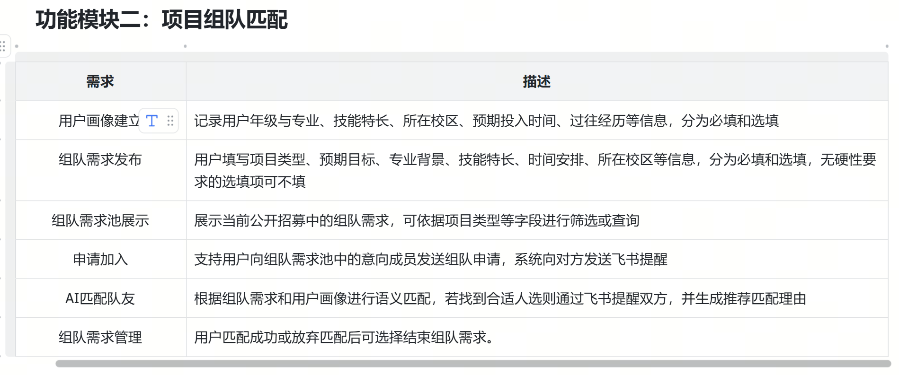

# 功能模块二 · 项目组队匹配 —— 设计文档

> **状态：设计阶段，尚未施工。** 本文记录 2026-10-12 与用户的讨论结论。
> 所有「❓」项必须先做探针（见 `docs/probe_checklist.md` 的 **S7**），**不许凭推测写死**。
>
> 关联文档：`docs/findings.md`（实测账本与决策 D9）、`PLAN.md` §6、`docs/genios_workflow_spec.md`。

---

## 1. 需求（来自赛事「功能模块二」）


（截图来源：赛事需求表，已存入 `docs/images/`）

| # | 需求 | 描述 |
| --- | --- | --- |
| 1 | 用户画像建立 | 年级与专业、技能特长、所在校区、预期投入时间、过往经历；分必填/选填 |
| 2 | 组队需求发布 | 项目类型、预期目标、专业背景、技能特长、时间安排、所在校区；分必填/选填 |
| 3 | 组队需求池展示 | 展示公开招募中的需求，可依项目类型等字段筛选或查询 |
| 4 | 申请加入 | 向意向成员发送组队申请，系统向对方发飞书提醒 |
| 5 | **AI 匹配队友** | 依组队需求与用户画像做**语义匹配**，找到合适人选则飞书提醒双方，并**生成推荐匹配理由** |
| 6 | 组队需求管理 | 匹配成功或放弃后可结束组队需求 |

> 需求 1、2、4、6 是**状态流转**；3 是**展示与筛选**；**5 是唯一的智能点**。
> 这个划分直接决定了下面「谁做什么」的分工。

---

## 2. 🔴 架构决定（D9）：飞书多维表格成为**业务数据的事实源**

**用户决定（2026-10-12）**：人员信息、需求池、机会汇总**全部**存飞书多维表格，**本地不再存业务数据**。

### 2.1 为什么这么定

- 多维表格**自带表单视图和筛选视图** → 需求 1/2/3 几乎零开发
- 多维表格**自带按钮字段 + 自动化** → 需求 4/6 几乎零开发
- GeniOS 有**飞书多维表格 OAuth2 插件**（9 个工具），可**直接读写**表格
- ⇒ **GeniOS 从「被调用的函数」变成「掌握数据与行动的主体」**，这才符合赛制「在 GeniOS 空间内搭建完整智能体应用」

### 2.2 新的分层

```
模块一 · 机会发现
  公众号 → We-MP-RSS → gateway `/ingest`（去重、排队、投递）
                                  ↓ 派发（只记任务状态，不落业务库）
                            GeniOS：判断 → 抽取 → 三层校验
                                  ↓ 飞书多维表格插件
       ┌────────────────────────────────────────────────┐
       │        飞书多维表格（业务数据唯一事实源）        │
       │  机会汇总 · 队友画像 · 组队需求 · 申请/匹配记录  │
       └────────────────────────────────────────────────┘
              ↑ 读写 ↓                         ↑ 表单 / 视图 / 按钮
        GeniOS：匹配 + 推送                   学生（飞书）

模块二 · 组队匹配
  学生 → 表单视图写入 → 多维表格
  点按钮 → 触发 → GeniOS 工作流：读表 → 硬筛 → 精排 → 写回 → 推卡片
```

| 层 | 谁负责 | 边界 |
| --- | --- | --- |
| **交互层** | 飞书多维表格（表单视图 / 网格视图 / 按钮字段 / 自动化） | 零代码 |
| **智能层** | **GeniOS** | 判断、抽取、校验、匹配、理由生成 —— 铁律 1 |
| **机制层** | gateway | **只剩「采集」+「可靠投递」**，不存业务数据 |
| **通知层** | 飞书自建应用（长连接推送，已打通） | — |

### 2.3 ⚠️ 这个决定带来三处**能力退化**，必须重新设计

| 退化 | 原来靠什么 | 现在要怎么办 |
| --- | --- | --- |
| **① 机会级去重** | SQLite `dedup_key UNIQUE` 约束 + `_merge_missing`（只补空缺不覆盖） | 多维表格**没有唯一约束**。改为工作流里 `search_records` 查重 → 有则 `update_records`、无则 `create_records`。**并把 `WORKER_CONCURRENCY` 降到 1 兜底**——否则两个 worker 并发处理同一活动的两篇文章会写出两条 |
| **② 推送去重** | `push_status` + 数据库原子性 | 字段保留（表格里加「推送状态」列），但**「查了再写」有窗口**。**验收第 4/5 条「重复文章不重复推送」必须重新实现、重新测** |
| **③ 字段形状** | `evidence` / `extra` 两个**嵌套 JSON** 列 | 多维表格**没有 JSON 字段类型**。要么序列化成文本（能存不能查），要么拆成扁平字段。**这是实打实的适配工作** |

---

## 3. 数据表设计（4 张表）

> ⚠️ **两张表的「技能清单」和「校区」必须用同一套枚举值**，否则硬筛的集合运算直接失效。
> 这是本设计最容易埋雷的地方。

### 3.1 队友画像（对应需求 1）

| 字段 | 类型 | 必填 | 用途 |
| --- | --- | --- | --- |
| 昵称 | 文本 | ✅ | 展示 |
| **年级** | 单选（大一…研三） | ✅ | **硬筛** |
| **专业 / 学院** | 单选（学院清单） | ✅ | **硬筛 + 语义** |
| **所在校区** | 单选（八里台 / 津南 / 泰达） | ✅ | **硬筛**（线下协作半径） |
| **技能标签** | 多选（编程/设计/文案/数据分析/实验操作/演讲…） | ✅ | **硬筛 + 语义** |
| **每周可投入** | 单选（<5h / 5–10h / 10–20h / >20h） | ✅ | **硬筛** |
| **想看什么** | 多选（= 机会的 4 类枚举） | ✅ | **个性化推送的依据**，见 §5.4 |
| 意向方向 | 多选（科研/竞赛/创业/志愿…） | 选填 | 硬筛 + 语义 |
| **过往经历** | 长文本 | 选填 | **纯语义** ← 最能体现大模型价值的字段 |
| 一句话自我介绍 | 长文本 | 选填 | 纯语义 |
| 飞书账号 | **人员字段** | ✅ | **身份**（自动带出 open_id，用户不用填） |
| 画像状态 | 单选（草稿 / 已完善） | 系统 | 决定是否进候选池 |

### 3.2 组队需求（对应需求 2）

| 字段 | 类型 | 必填 | 用途 |
| --- | --- | --- | --- |
| 需求标题 | 文本 | ✅ | 展示 |
| 发起人 | 人员字段 | ✅ | 身份 |
| **项目类型** | 单选 | ✅ | **硬筛 + 需求池的筛选维度** |
| 需要几名队友 | 数字 | ✅ | 展示 |
| **需要的技能** | 多选（同画像技能清单） | ✅ | **硬筛（求交集）** |
| **所在校区** | 单选 | ✅ | **硬筛** |
| **期望每周投入** | 单选 | ✅ | **硬筛** |
| **预期目标** | 长文本 | ✅ | **纯语义 ← 匹配的核心输入** |
| 专业背景偏好 | 文本 | 选填 | 半硬筛 + 语义 |
| 时间安排 / 周期 | 文本 | 选填 | 语义 |
| 联系方式 | 文本 | 选填 | 匹配成功后展示 |
| 需求状态 | 单选（招募中 / 已结束） | 系统 | 状态机 |

### 3.3 申请 / 匹配记录

记录「谁申请了谁」「AI 匹配给谁、给了多少分、理由是什么」，供展示与审计。

### 3.4 机会汇总（模块一的输出）

字段对齐现有 `Opportunity` 模型（见 `gateway/app/models.py`），但注意 §2.3-③ 的嵌套 JSON 问题。

### 3.5 **落地现状：表单里实际长这样**（2026-10-17）

上面 §3.1 / §3.2 是**当初的设计**，实际建表时砍掉了不少（`昵称`、`想看什么`、
`意向方向`、`一句话自我介绍`、`画像状态`、`需要几名队友`…）。
**以这张表为准**，答辩时别照着上面的旧表讲。

顺序由 `scripts/reorder_form_fields.py` 维护（可重复跑，改顺序 = 改代码）。

#### 【队友画像建档】（8 题，5 必填）

| # | 题目 | 类型 | 必填 | 为什么排这个位置 |
| --- | --- | --- | --- | --- |
| 1 | 飞书账号 | 人员 | ✅ | 身份，**预填**好了，一点就过 |
| 2 | 姓名 | 文本 | ✅ | 身份，**预填**；和上一题挨着，确认"就是你" |
| 3 | 技能标签 | 多选 | ✅ | 匹配的主维度，也是最有表达欲的一题 |
| 4 | 所在校区 | 单选 | ✅ | 硬筛 |
| 5 | 每周可投入 | 单选 | ✅ | 硬筛（和校区相邻） |
| 6 | 年级 | 单选 | 选填 | |
| 7 | 学院 | 文本 | 选填 | |
| 8 | 过往经历 | 长文本 | 选填 | **长文本永远最后** |

#### 【发布组队需求】（7 题，6 必填）

| # | 题目 | 类型 | 必填 | 为什么排这个位置 |
| --- | --- | --- | --- | --- |
| 1 | 发起人 | 人员 | ✅ | 身份，**预填** |
| 2 | 需求标题 | 文本 | ✅ | **整个匹配的主输入**（进提示词、进卡片、进邀请理由），必须靠前 |
| 3 | 项目类型 | 单选 | ✅ | 一拍即合 |
| 4 | 需要什么技能 | 多选 | ✅ | 硬筛 |
| 5 | 所在校区 | 单选 | ✅ | 硬筛 |
| 6 | 期望每周投入 | 单选 | ✅ | 硬筛 |
| 7 | 预期目标 | 长文本 | 选填 | **长文本永远最后** |

> **身份题的两层设计**：表单里**能看到**（预填的是本人，不用选），
> 真正的身份以系统字段 **`创建人`** 为准（飞书自动填提交人，改不了）。
> 详见 `docs/findings.md` Q18 / Q19。

---

## 4. 交互设计（对应需求 1/2/3/4/6）——几乎零代码

### 4.1 核心原则：**机器人管「推」，多维表格管「拉 + 操作」**

飞书官方范式。**不要把交互塞进机器人对话**——卡片字段少、状态难维护、还要处理多轮纠错，是无底洞。

### 4.1.1 小程序 vs 机器人：**权能边界**（2026-10-18 定）

后来加了小程序（`mini/` + `bff/`），多了一个能读能写的入口。**必须有一条判据**，
否则同一个动作会在两处实现，状态迟早打架。

> **判据：谁"主动发起"，谁负责推进到底；另一方只负责回应。**
>
> - **机器人 = 推**（打断你、告诉你发生了什么、让你当场决定）
> - **小程序 = 拉**（你主动打开、浏览、比较、录入）
> - **多维表格 = 事实源**（两边都读写，但不是给人用的界面）

| 能力 | 主场 | 为什么另一方不做 |
| --- | --- | --- |
| 机会推送 | 🤖 机器人 | 小程序**不会主动叫你**，只能等你打开 |
| 机会浏览 / 搜索 / 筛选 | 📱 小程序 | 聊天里塞十几条卡片是灾难 |
| 对话问答 | 🤖 机器人 | 小程序里再做一个对话框没必要 |
| 发布组队需求 | 📱 小程序（或表单） | 机器人里多轮补齐容易错 |
| **AI 匹配结果** | 🤖 机器人 | 后台算出来的，**必须主动推给用户** |
| 邀请 / 接受 | 🤖 机器人卡片 | 需要"点一下决定"，结果还要能回溯 |
| **申请加入** | 📱 发起 → 🤖 决策 | 两段式：你在小程序里挑，对方在飞书里批 |
| 我的画像（查看 / 修改） | 📱 小程序 | 机器人里改不了长表单；飞书表单**只能新增，改不了** |
| 系统告警（授权过期等） | 🤖 机器人 | 小程序不会告诉你"后台坏了" |

**三条边界规则：**

1. **一个操作只有一个入口。** 同一动作不要两处都能做。
2. **机器人永远不做"浏览"。** 最多推 3–5 张卡，不分页、不筛选；要做这些就丢链接进小程序。
3. **小程序永远不做"通知"。** 它拿不到后台事件，也不可能主动弹消息。

#### 这条边界已经落到数据里：`邀请.来源`

【邀请】表同时装两种方向，**光看行分不出方向**：

| `来源` | 卡片发给谁 | 谁按按钮 | 按完通知谁 |
| --- | --- | --- | --- |
| `匹配邀请` | 被邀请人 B | **B** | 发起人 A |
| `小程序申请` | 发起人 A | **A** | 申请人 B |

`match_flow._handle_invite_response` **以表里的 `来源` 为准**（卡片 `value` 只是兜底，
因为它可能过期）。少了这个字段，发起人点「同意」会被判成"这条邀请不是发给你的" ——
**表现为点了没反应**，是最难查的一类 bug。

### 4.2 「按钮」有四个落点

| 落点 | 机制 | 需要 inbound？ | 用哪个 |
| --- | --- | --- | --- |
| ① 卡片**链接按钮** | 跳转到表格视图 / 表单 / 原文 | ❌ 纯跳转 | ✅ 已在用（`genios/feishu_cards/instant.json`） |
| ② 卡片**回调按钮** | 飞书回调我们 | 长连接 ✅ / HTTP ❌ | 备选 |
| ③ 多维表格**按钮字段** | 点击 → 触发自动化 → 更新记录 / 发消息 | ❌ 飞书内部 | ✅ **首选** |
| ④ **表单视图**提交 | 填完 → 新增一行记录 | ❌ 飞书内部 | ✅ 录入用 |

### 4.3 关键发现：**飞书卡片的按钮也能触发多维表格自动化**

官方文档写明，「点击按钮时」触发条件支持三类按钮：
**数据表「按钮字段」、仪表盘「按钮组件」、消息卡片底部的「按钮」**。

⇒ 学生在飞书卡片上点一下，可以**直接触发表格里的自动化流程**，全程飞书内部，**不需要我们的服务参与，也不需要公网**。

### 4.4 需求 4/6 的完整落法（无后端代码）

```
需求池 = 「组队需求」表的一个共享视图（筛选 状态=招募中，按项目类型分组）   ← 需求 3

每条需求行上放按钮字段「我要报名」
   ↓ 点击 → 自动化：
   ① 「申请」表新增一行（申请人 = 当前用户，状态 = 待处理）
   ② 发飞书卡片给发起人，卡片上两个按钮「同意」「拒绝」

发起人点「同意」（同样是「点击按钮时」触发）
   ↓ 自动化：
   ① 申请状态 → 已接受
   ② 需求状态 → 已结束（匹配成功）      ← 需求 6
   ③ 发飞书消息给申请人
```

### 4.5 需求池视图

| 视图 | 怎么配 | 对应需求 |
| --- | --- | --- |
| **表单视图** ×2 | 建档、发需求 | 需求 1、2 |
| **网格视图 + 筛选** | 筛选 `需求状态=招募中`，按项目类型分组 | **需求 3，「零开发」** |
| **看板视图** | 按项目类型分列 | 演示效果好 |
| **画廊视图** | 需求卡片 | 浏览体验 |

**分享**：表格设「组织内可查看」，学生点链接直接看——**不需要写任何前端页面**。

---

## 5. 智能设计（对应需求 5）

### 5.1 🔴 第一原则：匹配是「互补」，不是「相似」

```
需求：我要找「会设计」的队友
  A：技能=设计   ← 和需求"很像"
  B：技能=编程   ← 和需求"不像"，但对发起人（会编程）是完美互补
```

**向量相似度会把 A 排第一。但该找的是 B。**

⇒ **不能用「语义相似度」当匹配度。** 相似度只能用于**召回**，真正的判断必须让大模型结合
**「发起人自己会什么 + 需求缺什么」**来推理。**节点 4 的输入必须带上发起人画像**，这是最容易被写漏的一环。

### 5.2 第二原则：表格行 → 自然语言（接口层）

多维表格里的一行是结构化数据，大模型看不懂「匹配度」。必须先拼接：

```
{年级:"大二", 学院:"计算机", 技能:["编程","数据分析"], 校区:"津南", 周投入:"10-20h", 经历:"…"}
        ↓ 代码节点拼接
"[0] 大二 · 计算机学院 · 技能：编程、数据分析 · 校区：津南 · 每周 10-20h · 经历：…"
```

**没有这一步，后面的语义匹配无从谈起。**

### 5.3 两段式：先硬筛，再语义

| 方案 | 候选规模 | 评价 |
| --- | --- | --- |
| 全表塞提示词 | ≤ 50 人 | 最简单，初期够用 |
| **代码硬筛 + 大模型精排** | ≤ 1000 人 | ✅ **推荐起步** |
| 知识库向量召回 + 大模型精排 | 几千+ | 标准做法，但多一层同步 |
| 纯向量相似度 | — | ❌ 见 §5.1，方向就是错的 |

**为什么推荐中间那个**：硬筛用的是**枚举字段**（校区/技能/投入），代码节点直接比，不需要任何智能；
硬筛的理由天然可解释（「不同校区」），大模型只负责解释「**为什么这两个人搭**」；
且**平台能力全是已验证的**（代码节点 ✅、大模型节点 ✅），只差「读表」那一个 ❓。

### 5.4 个性化推送（用户 2026-10-12 提出）

**用户方案**：学生在画像里**手动勾选「想看什么」**（= 机会的 4 类），推送时查这个字段再决定推不推。

**评估**：逻辑正确，但**那是个 `WHERE type IN (...)`——是查询，不是理解**。
如果个性化只剩这一句，GeniOS 又薄了一分。建议切成两段：

| 层 | 放哪 | 干什么 | 理由 |
| --- | --- | --- | --- |
| 交集 | 表格筛选 / 代码 | `机会.type ∈ 学生.想看什么` | 纯查询，零 LLM 成本 |
| 细排 + 文案 | **GeniOS** | 一周命中 10 条 → 排出最该看的 3 条，**生成一句「为什么值得你看」** | 规则做不到 |
| **长期记忆** | **GeniOS** | 学生勾了「竞赛」但从不点竞赛 → **学出真实偏好**，自己调权 | **这才是智能** |
| 模糊相关 | **GeniOS** | 「创新创业大赛」没被归为竞赛但很相关 → 捞回来 | 规则做不到 |

⚠️ **成本**：若按「每个学生一次调用」做，100 学生 × 10 篇/天 = **1000 次调用/天**，还要轮询 3–30 秒，**跑不动**。
**必须批量**：一次调用传「一条机会 + N 个候选学生的偏好」→ 返回「推给谁 + 每人推荐语」。**1 次而非 N 次。**

### 5.5 组队匹配工作流（节点图）

```
Start：触发（有新的待匹配需求）
  │
  ├─ 节点1 ·【多维表格插件】读「组队需求」表 → 需求全文 + 发起人 open_id
  ├─ 节点2 ·【多维表格插件】读「队友画像」表 → 候选（排除发起人自己）
  │
  ├─ 节点3 ·【代码节点】拼文本 + 硬筛
  │        校区相同 ∧ 投入满足 ∧ 技能交集非空   → 500 人 → 25 人
  │
  ├─ 节点4 ·【大模型节点】精排 + 生成理由
  │        输入：需求全文 + **发起人画像（他会什么，才能算互补）** + 25 人画像
  │        输出：{"matches":[{"idx":3,"score":88,"reason":"你缺设计，对方有…"}]}
  │
  ├─ 节点5 ·【代码节点】校验 + **防幻觉**
  │        idx 不越界 ∧ score 有锚点 ∧ reason 非空
  │        **把 idx 映射回真实 open_id** ← 否则大模型会编造出不存在的用户
  │
  ├─ 节点6 ·【多维表格插件】写回「匹配记录」表
  ├─ 节点7 ·【飞书插件】给发起人和候选人推卡片（含理由）
End
```

| 节点 | 平台能力 | 状态 |
| --- | --- | --- |
| 读表 / 写表 | 飞书多维表格 OAuth2 插件 | ❓ **唯一未知项（S7）** |
| 拼接 + 硬筛 | 代码节点（Python 3.10） | ✅ 已验证 |
| 精排 + 理由 | 大模型节点 | ✅ 已验证 |
| 校验 + 防幻觉 | 代码节点 | ✅ 已验证 |
| 推卡片 | 飞书插件 / 已有卡片 | 部分 ✅ |

### 5.6 对话式查询 vs 工作流 —— 建议**混用**

| | Agent 模式 | 工作流模式 |
| --- | --- | --- |
| 谁决定调什么 | 大模型自己选工具 | 我们写死节点顺序 |
| 优点 | 灵活 | 可控、快、便宜、**可解释、答辩好讲** |
| 缺点 | 不稳、慢、贵 | 不灵活 |

**分场景**：**组队匹配走工作流**（逻辑固定，要可靠要能解释）；**对话式查询走 Agent**（用户随便问）。
两者可合起来——GeniOS 有「工作流节点」，**Agent 调工作流**：
**Agent 负责「听懂」，工作流负责「做对」。**

### 5.7 ⚠️ 多维表格插件是**底层 CRUD**，不是业务工具

平台提供的 9 个工具：
`create_base` / `create_table` / `delete_table` / `get_base_info` / `list_table`
/ `create_records` / `update_records` / `delete_records` / `search_records`

**`search_records` 的 `filter` 是结构化条件表达式，不是自然语言。** 大模型必须自己翻译：

```
用户：帮我找个会设计的、津南校区的同学
   ↓ 大模型翻译
search_records(table_id="队友画像",
  filter=[{field:"技能", op:"contains", value:"设计"},
          {field:"校区", op:"is",       value:"津南"}])
```

**硬边界**：

| 用户说的 | 能否翻译成 filter |
| --- | --- |
| 「会设计的」「津南校区」「大二的」 | ✅ 能（字段是枚举，语义无歧义） |
| 「性格合得来的」「时间不冲突的」「靠谱的」 | ❌ **不能**（多维表格表达不了） |

⇒ **`search_records` 只能做「结构化筛选」，做不了「语义匹配」。**
**插件给的是取数能力，不是智能。智能在于大模型拿到数据之后怎么判断。**

### 5.8 表结构**写死在提示词里**，别让大模型自己发现

在系统提示词里写明三/四张表的 `table_id` 与字段 schema：

```
你可以访问以下数据表：
【表1】队友画像  table_id=tblXXXX
  姓名(文本) 年级(单选) 学院(单选) 技能(多选) 校区(单选) 每周投入(单选) 经历(文本)
【表2】组队需求  table_id=tblYYYY
  …
```

> ❌ **不要**依赖大模型先调 `list_table` 自己发现——多一次往返、不稳定、可能选错表。
> `table_id` 本来就是稳定的，**静态写死**。

---

## 6. 隐私（赛事有此项要求）

**一条原则**：**画像完整内容只对本人可见**；对他人只呈现 **AI 生成的匹配理由**；
飞书提醒里**不直接暴露**对方完整画像与联系方式。用户可随时删除画像。

⚠️ **待验证**：多维表格能否做**字段级 / 记录级权限**（画像表只让本人看自己那行）。
做不到的话，隐私方案要改成「画像表不共享 + 另建脱敏展示表」。见 S7。

---

## 7. 安全：4 个危险工具不要给 Agent

```
create_base    create_table    delete_table    delete_records
```

给对话 Agent 用这一套 = **给了它建库删表的权限**。用户一句「把没用的数据清理一下」，它可能真的去 `delete_records`。

**规则**：
- **Agent 模式只暴露只读工具**：`get_base_info` / `list_table` / `search_records`
- **写操作一律走工作流**，参数由代码节点产出（大模型碰不到）
- 真要给 Agent 写权限，**只给 `update_records`（限定字段），永不给 delete / create**

---

## 8. 对现有代码的影响

| 东西 | 变化 |
| --- | --- |
| SQLite `Opportunity` / `OpportunitySource` 表 | **不再存业务数据**。SQLite 只留 `Article`（管道状态：去重、队列、重试） |
| `POST /opportunities`（GeniOS 回写用） | **可以删掉**——GeniOS 直接写表格，不再回调我们 |
| `GET /opportunities` | 要改成「读表格」或由插件读。**先确认谁还在用**（weekly 卡片、推送路由） |
| `worker` 的角色 | 变成「**管可靠投递**」：派发 + 失败重试。不再落业务库、不再推飞书 |
| `push_status` / 去重逻辑 | 见 §2.3，**必须重新实现** |
| `docs/genios_workflow_spec.md` | **部分失效**——里面「HTTP 请求节点回写 gateway」的节点图不再成立 |
| `genios/code_nodes/parse_and_validate.py` | 输出形状未变，但**去向**变了（写表格而非回写 HTTP） |

---

## 9. 平台事实（2026-10-12 查证）

| 事实 | 来源 | 状态 |
| --- | --- | --- |
| 多维表格**按钮字段**点击可触发自动化流程 | 飞书官方帮助文档 | ✅ 文档 |
| 「点击按钮时」触发条件支持**数据表按钮 / 仪表盘按钮 / 卡片按钮** | 飞书官方帮助文档 | ✅ 文档 |
| 按钮字段执行操作含：打开链接 / 打开表单 / 发送飞书消息 / 新增记录 | 飞书官方帮助文档 | ✅ 文档 |
| 多维表格 API 频控 **50 次/秒**；单次新增 **≤500 条**；单表 **≤20,000 条**；**写入不支持并发**（`1254291 Write conflict`） | 飞书开放平台 API 文档 | ✅ 文档 |
| 写表权限 scope：`bitable:app` 或 `base:record:create`；应用还须是该表格的**协作者** | 飞书开放平台 API 文档 | ✅ 文档 |
| 从其他数据源**同步的**数据表不支持增删改 | 飞书开放平台 API 文档 | ✅ 文档 |
| **GeniOS 能出网访问 `open.feishu.cn`** | 我们的 S5 实测（返回真实飞书错误码 19001） | ✅ **实测** |
| 多维表格 OAuth2 插件提供 9 个工具 | 用户提供（平台界面） | ✅ 用户 |
| **OAuth2 token 能否自动刷新** | — | ❓ **生死线，见 S7** |

---

## 10. 进度与下一步

### ✅ 已产出（2026-10-14）

**GeniOS 侧（智能层）** —— 已在平台上跑通并**写回表格成功**

| 产出 | 位置 |
| --- | --- |
| 硬筛 + 拼文本代码节点 | `genios/code_nodes/match_hard_filter.py` |
| 校验 + 防幻觉映射代码节点 | `genios/code_nodes/match_validate.py` |
| 组装写回入参代码节点 | `genios/code_nodes/build_update_payload.py` |
| 大模型提示词（互补优先 / 只回 idx / 分数分档） | `genios/prompts/step2_match.md` |
| **可导入的工作流文件** | `genios/workflows/campus_team_match.import.json` |
| 工作流生成器 | `scripts/create_genios_match_workflow.py` |
| 搭建说明 + 试运行 payload | `docs/genios_workflow_module2_spec.md` |

链路：`Start → 插件search_records → 代码01 → 大模型01 → 代码02 → 代码03 → 插件update_records → End`
**端到端实测通过**，见 `docs/findings.md`「功能模块二 · 智能链路 + 写回」。

**gateway 侧（机制层 + 通知层）**

| 产出 | 位置 | 干什么 |
| --- | --- | --- |
| 多维表格客户端 | `gateway/app/bitable.py` | 读写三张表（应用身份） |
| 卡片构建 | `gateway/app/match_cards.py` | 卡片 A / 卡片 B / 无匹配卡 |
| 匹配编排 | `gateway/app/match_flow.py` | 轮询→派发→推卡；卡片回调分派 |
| 常驻服务 | `scripts/match_service.py` | 长连接收回调 + 定时轮询 |
| 多工作流配置 | `config.py::MatchGeniosProfile` | 让同一个 `GeniosClient` 接第二个工作流 |
| 测试（22 个用例） | `gateway/tests/test_match_flow.py` | |

**测试**：`cd gateway && ../.venv/bin/pytest` → **163 passed**。

**三张表**（探针 base `<BITABLE_APP_TOKEN>`）：
队友画像 `tblbUBezczIB54Th` · 组队需求 `tblvOY1UxwcsHSK9` · 邀请 `tbloPpPgRSmeSk72`

### ⬜ 还差一步：**开多维表格的应用身份权限**（[人]，开放平台）

gateway 走**应用身份**读写表格，而自建应用 `cli_aa4ede…` **没开通 bitable 权限**，
实测报 `99991672`。去开放平台开通（任一）：`bitable:app` / `bitable:app:readonly` +
`base:record:retrieve`，**并把应用加为目标表格的协作者**。

申请链接平台会直接返回，例：
`https://open.feishu.cn/app/<应用ID>/auth?q=…` —— **完整链接跑 `scripts/match_service.py` 时会连同报错一起打出来**，直接点它就行

开完之后 `scripts/match_service.py` 就能跑通整条闭环。

### ⬜ 更远的（本轮没做）

- **卡片原地更新**：点完按钮把按钮改成「已邀请」/「已回应」（现在只回 toast）
- **对话入口**：Agent 调这个工作流（「帮我找队友」）
- **模块一的**机会表迁到多维表格 + 改 gateway（§8）
